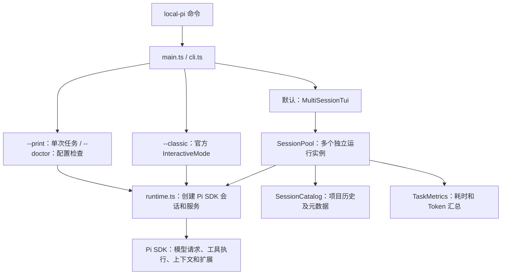

# Local Pi 当前功能与实现说明

整理日期：2026-10-29。对象为当前工作目录中的源码，应用版本 `0.1.0`。

本文根据 `package.json`、`src/`、`resources/` 和 `test/` 核对实现；README 用于辅助对照。功能清单表示已有代码路径，不表示所有功能均通过本次运行验证。本文不复盘业务项目的历史操作，也不读取或收录认证凭证、私人对话内容。

## 1. 项目定位

Local Pi 是基于 Pi SDK 开发的个人终端编程助手。目前提供多会话终端界面，支持在不同会话中讨论代码、调用工具、执行任务和查看结果，也保留上游单会话界面与单次任务入口。

它不是单纯的模型聊天 API 包装。模型调用、agent 执行循环、工具执行、会话上下文、重试和压缩等基础机制复用 Pi SDK；本项目重点实现会话组织、模式控制、交互布局和状态展示。

### 技术组成

| 层次 | 当前采用的技术 | 用途 |
| --- | --- | --- |
| 运行环境 | Node.js，声明要求 `>=22.19.0` | 运行 TypeScript 源码和构建后的命令 |
| 开发语言 | TypeScript `5.9.3`，ES Modules | 类型检查、模块组织与构建 |
| Agent SDK | `@earendil-works/pi-coding-agent@1.3.0` | 模型、工具、会话、扩展、认证及原生界面组件 |
| 终端组件 | `@earendil-works/pi-tui@1.3.0` | 全屏终端、输入、滚动、列表、布局及键位管理 |
| 本地状态 | SDK JSONL + 自定义 JSON 索引 | 对话保存、历史列表、模式和任务统计 |
| 自动测试 | Node.js `node:test` | 使用模拟模型、内存终端和临时工作目录测试 |

依据：[依赖与命令入口](../package.json)、[编译配置](../tsconfig.json)。

## 2. 整体架构



一次普通任务的主要流程：

1. 终端输入先由 `MultiSessionTui.dispatch()` 判断是否为本地命令、对话框回答或模型任务。
2. 本地命令直接处理；已注册的扩展、提示模板和技能命令交给 SDK；不支持的命令明确报错。
3. 普通任务进入 `SessionPool.submit()`，检查会话和同目录执行状态，保存正式会话索引并开始统计。
4. 调用 `session.prompt()`，由 SDK 组织上下文、请求模型、执行工具并继续后续轮次。
5. SDK 事件进入所属 `SessionSlot`；界面据此更新流式消息、工具卡片、Working、未读和用量。
6. 根据 `agent_settled` 等生命周期信号收尾、保存历史，并显示本次任务报告。

## 3. 启动与运行方式

| 方式 | 已实现行为 |
| --- | --- |
| `local-pi` | 在启动目录进入默认多会话全屏 TUI |
| `--cwd <目录>` | 指定目标代码目录，校验其存在并解析真实路径 |
| `--continue` | 默认多会话模式下恢复当前项目最近正式会话，跳过空白记录 |
| `--session <JSONL路径>` | 恢复指定会话，校验会话所属工作目录 |
| `--model provider/model-id` | 为运行指定模型，检查标识和可用模型 |
| `--agent-dir <目录>` | 指定 Pi 配置目录 |
| `--classic` | 使用官方 `InteractiveMode`，保留本项目运行时和工作区扩展 |
| `--print "任务"` | 不启动 TUI，流式输出一次任务结果；工具状态写入 stderr；支持 SIGINT 中断 |
| `--doctor` | 输出目录、模式、模型、工具、扩展命令和诊断；不发送模型请求 |
| `--help` / `-h` | 输出帮助 |

`--continue` 与 `--session` 互斥。普通 TUI 要求 stdin、stdout 为交互式终端。

`package.json` 的 `bin` 将 `local-pi` 指向 `dist/main.js`。开发时 `npm start` 直接运行 `src/main.ts`；构建使用 `tsc` 输出到 `dist/`。构建和 `npm link --ignore-scripts` 后可在其他项目目录使用命令；修改源码后需重新构建、重启已运行的命令。

依据：[入口](../src/main.ts)、[参数解析](../src/cli.ts)。

## 4. SDK 运行时、配置与资源

`createRuntime()` 使用 `createAgentSessionServices()`、`createAgentSessionFromServices()` 和 `createAgentSessionRuntime()` 组合会话运行环境，没有自行重写 agent 执行循环。

- 默认通过 SDK 的 `getAgentDir()` 使用 Pi 配置目录，通常为 `~/.pi/agent`。
- 复用 SDK 的认证、模型、设置、上下文和资源加载机制。
- 注入 `createWorkspaceExtension()`，提供本项目模式和命令。
- 将 `resources/coding.md` 追加到系统提示，将 `resources/prompts/` 加入提示模板发现路径。
- 注册读取、编辑、写入、搜索和系统命令工具，再根据当前模式选择暴露给模型的工具。
- 指定模型、恢复模式与推理等级，并订阅独立会话事件。

项目资源和扩展沿用 SDK 发现机制，不应将某个 SDK 或外部扩展的潜在能力当成本项目默认已接入的能力。例如本项目运行时没有显式创建 MCP 扩展或实现内置子 agent 调度器。

依据：[runtime.ts](../src/agent/runtime.ts)、[coding.md](../resources/coding.md)、[审查模板](../resources/prompts/code-review.md)。

## 5. 多会话与后台执行

### 5.1 独立会话实例

`SessionPool` 使用 `Map<sessionId, SessionSlot>` 保存多个运行实例。每个实例分别维护 SDK runtime、任务 Promise、流式消息、工具状态、运行状态、未读标记、通知、统计和压缩期间的队列。

`activate()` 只改变 `activeId` 并通知界面，不停止或销毁离开的会话。因此 A 运行时可以切到 B；A 的 SDK 请求和工具进程继续工作。切回 A 会显示原实例的最新状态。

界面为每个会话保留自己的编辑器、滚动区、消息组件、Working 和剪贴板适配器，从而保留草稿、滚动位置及展开状态。

### 5.2 会话状态与生命周期

- 显示空闲、运行中、等待处理、失败状态。
- 后台输出标记未读；后台任务结束通知当前会话。
- `/stop [编号]` 定向停止一个会话；不会因为切换而停止。
- `/close [编号]` 关闭实例，正式历史保留；运行中或等待处理的会话需要先处理或停止。
- `/quit` 在有任务时确认停止全部；退出程序会销毁所有运行实例。
- 同一个进程内，同一真实工作目录同时只允许一个普通执行模式任务；其他会话仍可讨论。

限制：后台执行仅在当前进程存活期间有效，没有常驻服务、崩溃后续跑或跨进程任务协调；目录比较也不是 SVN 工作副本或 Git 仓库级的文件锁。

### 5.3 会话分叉 `/fork`

`/fork` 使用消息选择器，从当前分支完整、已保存的用户消息或正常结束的助手消息创建独立会话，保留到所选消息（含）。Esc 取消，不修改原会话；原任务可继续运行。

实现位于 `src/agent/fork.ts` 与 `SessionPool.fork()`：在独立 SessionManager 上调用 SDK 的 `createBranchedSession()`，通过现有运行时工厂创建新实例并加入会话池。不能直接使用会停止源任务的 runtime 替换式 fork。分叉前发送可取消的 `session_before_fork`，新实例收到 reason 为 fork 的 `session_start`。

新会话默认讨论模式，继承所选位置的上下文、模型和等级；独立维护队列、草稿、运行状态和任务统计。分叉来源以自定义条目和索引保存，在列表与统计页展示。旧任务报告不当作子会话的最近任务，SDK 累计用量仍包含继承历史。分叉不复制或回滚代码，不提供文件隔离；共用目录时原有执行互斥仍生效。

依据：[session-pool.ts](../src/agent/session-pool.ts)、[multi-session.ts](../src/tui/multi-session.ts)。

## 6. 历史、临时页与恢复

SDK 负责对话 JSONL；`SessionCatalog` 负责历史列表的辅助索引，不替代 SDK 上下文。

```text
.local-pi/sessions/
  <工作目录 SHA-256 前16位>/
    <SDK会话文件>.jsonl
    metadata/
      <sessionId>.json
```

Windows 下目录哈希前将路径转为小写。索引包含 ID、工作目录、会话文件路径、名称、标题、时间、模式、模型、推理等级和正式会话标记等；写入采用临时文件再重命名。

已实现的规则：

- 启动的新空白页属于临时页，不写入正式历史索引。
- `/new` 优先复用当前项目没有草稿、没有任务的临时页，避免连续生成空白历史。
- 第一次提交提问后进入正式历史，即使请求随后失败或取消也保留。
- 未发送草稿仅在内存中保留，退出不保存。
- 首次提交在 SDK 写入消息前失败时，索引暂存 `pendingPrompt`，恢复后可查看但不自动重发。
- 历史列表按 ID 合并、去重，默认包含当前项目正式历史和本进程已打开的正式会话或草稿。
- 其他项目的历史不会全部混入，但其他项目的已打开会话可以切回。
- 正式会话文件缺失且没有可恢复的待提交记录时明确报错，不创建空白对话冒充恢复成功。
- 模式和统计沿用会话当前分支；不会从已放弃分支随意取状态。

这里的会话索引和临时页“快照”指内存元数据，**不是代码文件备份或工作区回滚快照**。

依据：[session-catalog.ts](../src/agent/session-catalog.ts)。

## 7. 讨论／执行模式与工具

| 模式 | 默认开放给模型的工具 | 行为 |
| --- | --- | --- |
| 讨论 `discuss` | `read`、`grep`、`find`、`ls` | 新会话默认模式，读取和分析 |
| 执行 `execute` | 上述工具 + `edit`、`write` + Windows 的 `powershell` 或其他系统的 `bash` | 可编辑文件并执行系统命令 |

`/execute`、`/discuss` 由扩展直接切换，不请求模型判断，不自动开始任务；执行过程中需先停止才能切换。

模式控制通过三部分实现：

1. 调整 active tools，并在 `tool_call` 事件阻止讨论模式下的非读取工具。
2. 将模式存入 `local-pi-mode` 自定义会话条目，以便恢复。
3. 切换时发送模型可见状态通知，并在 `before_agent_start` 更新系统提示和工具说明，减少旧对话模式信息造成的误判。

这是应用层工具控制。`--cwd` 不提供系统沙箱，已加载扩展与工具仍使用进程权限；本项目执行模式没有命令风险分级、危险 SVN/Git 操作审批或文件覆盖保护。

依据：[mode.ts](../src/agent/mode.ts)、[workspace.ts](../src/extensions/workspace.ts)。

## 8. 消息队列、压缩与输入辅助

| 功能 | 当前实现方式 |
| --- | --- |
| 运行中追加要求 | Enter 调用 SDK `steer()`，在当前助手工具轮次后处理 |
| 排队后续任务 | 调用 SDK `followUp()`，当前待处理工作结束后继续 |
| 取回待发送消息 | `clearQueue()` 合并 SDK 队列与本地压缩队列，恢复到所属会话草稿 |
| 手动压缩 | `/compact [要求]` 在空闲检查后调用 `session.compact()`；运行中的任务不会因该入口被自动中断 |
| 压缩期间输入 | 暂存在 `compactionQueue`，成功后继续投递；失败保留供取回 |
| 复制回答 | `/copy` 复制最近助手正文；快捷键在相应设置下优先复制选中内容 |
| 外部编辑器 | `/editor` 复用 Pi 编辑器流程，暂停终端交互，退出后回填原会话草稿；不自动发送，不停止后台 SDK 任务 |
| 文件／截图／文字粘贴 | 按文件路径、图片、普通文本顺序读取剪贴板；图片保存到临时文件后将路径插入输入框 |

异步粘贴使用 generation 标记处理取消，发送、清空、替换草稿或关闭会话后不会把迟到的粘贴结果插入新草稿。图片提交后沿用 SDK 的文件读取流程，需要模型及工具支持图片。

依据：[session-pool.ts](../src/agent/session-pool.ts)、[clipboard.ts](../src/tui/clipboard.ts)、[multi-session.ts](../src/tui/multi-session.ts)。

## 9. TUI、模型、设置与展示

### 9.1 聊天与工具结果

- 用户消息靠右，带“你”标题和边框；助手消息靠左。
- 消息正文复用 `UserMessageComponent`、`AssistantMessageComponent`，保留 Markdown、代码高亮和中文宽度处理。
- 思考内容支持折叠、展开和隐藏；只有模型实际返回思考内容时才显示。
- 工具以卡片展示名称、状态、命令或路径和耗时；点击标题或批量操作展开结果。
- 展开内容使用 `ToolExecutionComponent`；本界面不再按固定 1800 字符截断，但工具本身的输出上限仍有效。
- 按会话缓存组件及展开状态，流式更新和主题切换不随意重置；查看旧内容时可暂停自动跟随，再回到最新输出。

### 9.2 推理等级和 Working

- `/thinking` 复用 `ThinkingSelectorComponent`；通过 SDK 获取当前模型支持的等级。
- Shift+Tab 循环等级；选择器 Ctrl+S 保存默认值；普通选择只改变当前会话。
- 输入框边框按官方主题的推理等级颜色渲染。
- 等级控制与思考内容折叠分开；运行中调整等级不重发当前请求。
- 输入框复用 `CustomEditor`，Working 动画由公开 `Loader` 适配。
- 显示 Working、Retrying、Compacting context、Waiting for input 和任务耗时。
- 切走只暂停该视图动画；任务仍执行，切回恢复实际状态。

### 9.3 模型、认证、主题和设置

- `/model` 使用官方模型选择器，支持搜索、当前会话切换及保存默认模型。
- `/login` 调用 `ModelRuntime.login()`，按提供方能力支持 API Key 或 OAuth；秘密输入以掩码展示。
- `/theme` 使用官方选择器和主题控制器，支持预览、取消恢复、保存及 `light/dark` 配置。
- 同一配置目录的已打开会话同步主题选择；主题来自 SDK 发现的资源。
- `/settings` 使用官方 `SettingsSelectorComponent` 与 `SettingsManager`，连接压缩、队列、传输、图片、模型等级、输入框、滚动、复制等设置。
- 部分菜单项仅保存供 classic 使用；多会话布局固定 fullscreen，不能由设置切换成另一布局。
- `/session`、`/hotkeys` 使用只读滚动面板，不写入模型上下文。

### 9.4 扩展交互

为每个会话适配 select、confirm、input、editor、通知、状态、编辑器和 Working 接口。后台会话需要输入时标记等待，切回原会话处理。`ui.custom()` 明确报错并建议使用 `--classic`，并非所有官方扩展 UI 都已兼容。

依据：[transcript.ts](../src/tui/transcript.ts)、[working.ts](../src/tui/working.ts)、[settings.ts](../src/tui/settings.ts)、[info-panel.ts](../src/tui/info-panel.ts)、[multi-session.ts](../src/tui/multi-session.ts)。

## 10. 任务耗时、Token 与底栏

`TaskMetrics` 在任务开始记录 SDK 累计 Token 基线和 `performance.now()`；结束时计算耗时及统计差值。

- 耗时包含模型等待、工具执行、等待确认、自动重试和自动压缩；切换会话不重置。
- 同一 SDK 运行周期中的 steering 和 follow-up 共用统计区间，不保证每条追加消息都有独立报告。
- 汇总输入、输出、缓存读写与总 Token，状态区分完成、失败和停止。
- 无用量显示未知；部分成功响应无用量时标记不完整，不补造数据。
- 统计通过 `local-pi-task-metrics` 自定义条目保存，不作为模型消息。
- 旧历史没有耗时记录时不倒推；异常退出留下的运行记录显示未知。
- 官方 `FooterComponent` 显示会话累计用量、模型、上下文占用及扩展状态。
- 上下文占用可能为 SDK 估算，不等同于累计 Token；SDK 费用估算不等于套餐扣额，未接入套餐剩余额度。

这些自定义逐任务统计主要在默认多会话入口接入；不能直接认为 `--classic`、`--print` 也使用相同任务报告逻辑。

依据：[task-metrics.ts](../src/agent/task-metrics.ts)、[底栏及统计页](../src/tui/multi-session.ts)。

## 11. 常用命令和默认键位

以下针对默认多会话界面。快捷键可被 Pi 配置目录的 `keybindings.json` 覆盖，`/hotkeys` 展示实际绑定和冲突。

| 分类 | 命令／快捷键 |
| --- | --- |
| 会话管理 | `/new [目录]`、`/sessions`、`/resume`、`/switch 编号`、`/name 名称`、`/fork`；Ctrl+N 新建，Ctrl+P 列表 |
| 生命周期 | `/stop [编号]`、`/close [编号]`、`/quit`；Esc 停止，Ctrl+D 空草稿退出 |
| 工作模式 | `/discuss`、`/execute`、`/project` |
| 变更审查 | `/changes` 展示 Git 状态和 diff；`/code-review [关注点]` 展开审查提示模板 |
| 模型和认证 | `/model [provider/id]`、`/login [provider]`；Ctrl+L 模型选择 |
| 推理与显示 | `/thinking [等级]`、`/thinking-display [collapse/expand/hide]`、`/tools [expand/collapse]`；Shift+Tab、Ctrl+T、Ctrl+O |
| 设置与信息 | `/settings`、`/theme [主题]`、`/session`、`/hotkeys`、`/help` |
| 队列与压缩 | `/dequeue`、`/compact [摘要要求]`；运行中 Enter 追加 |
| Windows / WSL 后续队列 | Ctrl+Q 排队，Alt+Q 取回；其他系统默认 Alt+Enter、Alt+Up |
| 剪贴板与外部编辑 | `/copy`、`/editor`；Ctrl+X 复制，Ctrl+G 外部编辑；Windows / WSL Alt+V 粘贴，其他系统 Ctrl+V |

未知斜杠命令和未接入的官方命令会提示，不自动作为普通任务发送模型；已注册扩展、模板和启用的 `/skill:名称` 继续交给 SDK。

`/changes` 和审查模板目前围绕 Git 编写，**没有 SVN 专用的变更面板或冲突合并实现**。模型可通过执行模式的通用命令工具运行 SVN，这不等于程序有 SVN 语义保护。

依据：[命令路由](../src/tui/multi-session.ts)、[键位注册](../src/tui/keybindings.ts)、[工作区扩展](../src/extensions/workspace.ts)。

## 12. 复用 SDK 与本项目自定义的边界

| 领域 | Pi SDK／官方组件负责 | 本项目补充 |
| --- | --- | --- |
| Agent 执行 | 模型请求、工具循环、上下文、重试、压缩 | 创建服务、选择工具和模式说明 |
| 多会话 | 独立 AgentSession 与 SessionManager | SessionPool、后台事件归属、活动视图和同目录限制 |
| 历史 | JSONL、消息和分支 | 正式历史索引、空白页规则、标题和列表合并 |
| 界面 | 终端基础组件、消息、编辑器、选择器、底栏 | 布局、气泡、卡片、每会话交互和菜单接线 |
| 队列 | steer、followUp、clearQueue | 快捷键、待发送展示、压缩期间排队和草稿恢复 |
| 统计 | getSessionStats 提供累计数据 | 任务区间、统计差值、持久化报告和呈现 |
| 权限 | 工具与扩展事件机制 | 讨论／执行工具集及只读模式拦截 |

兼容性例外：`pi-ui.ts` 通过安装包内部路径加载主题、底栏数据、命令清单、剪贴板、HTTP 和外部编辑器模块，因为这些接口没有全部从公开入口导出。它严格检查 coding-agent 版本为 `1.3.0`。因此不能把当前实现描述为“完全只依赖公开 API”；升级 SDK 时必须复核此兼容层。项目没有通过修改 `node_modules` 实现这些适配。

依据：[pi-ui.ts](../src/tui/pi-ui.ts)。

## 13. 当前限制与未实现项

| 项目 | 当前情况 |
| --- | --- |
| 退出后继续任务 | 未实现；退出停止所有实例 |
| 多进程／仓库级互斥 | 未实现；只有当前进程的同目录执行检查 |
| 系统沙箱 | 本项目未实现；工作目录参数不是权限边界 |
| 危险操作审批 | 未实现 SVN/Git/删除/覆盖等风险分级和专用审批 |
| 自动文件快照与回滚 | 未实现；聊天历史、会话索引、任务统计不备份代码 |
| 自动保护既有修改 | 提示词要求保留，尚无程序级功能保留验证或强制保护 |
| SVN 集成 | 无专用面板、三方合并流程或冲突保护 |
| 内置子 agent 调度 | 未见本项目默认实现；多会话是用户管理的独立实例 |
| 完整官方命令 | `/tree`、完整 `/reload` 等未接入默认多会话界面；`/fork` 已接入独立多会话实现 |
| 任意扩展 UI | `ui.custom()` 不支持；需使用 classic |
| 部分原生设置 | 分享、Mermaid、会话树、部分通知和启动／退出行为只保存或提示 classic |
| 套餐计费与额度 | 只显示 SDK 用量／费用估算，未查询实际扣额与余额 |
| 未发送草稿恢复 | 只保留在当前进程，退出不落盘 |
| Web／远程服务 | 当前为本地 CLI/TUI，没有项目自建 Web 服务 |

## 14. 源码导航

| 文件 | 主要职责 |
| --- | --- |
| [main.ts](../src/main.ts)、[cli.ts](../src/cli.ts) | 入口、运行分支与参数校验 |
| [runtime.ts](../src/agent/runtime.ts) | SDK 服务、模型、会话与资源配置 |
| [mode.ts](../src/agent/mode.ts)、[workspace.ts](../src/extensions/workspace.ts) | 模式、工具和自定义命令 |
| [session-pool.ts](../src/agent/session-pool.ts) | 会话池、生命周期、后台事件、队列 |
| [fork.ts](../src/agent/fork.ts) | 完整分叉位置筛选及来源元数据 |
| [session-catalog.ts](../src/agent/session-catalog.ts) | 历史索引与恢复 |
| [task-metrics.ts](../src/agent/task-metrics.ts) | 逐任务计时与用量报告 |
| [multi-session.ts](../src/tui/multi-session.ts) | 终端宿主、菜单、键盘和命令路由 |
| [transcript.ts](../src/tui/transcript.ts)、[working.ts](../src/tui/working.ts) | 消息展示、工具卡片、编辑器与运行反馈 |
| [settings.ts](../src/tui/settings.ts)、[info-panel.ts](../src/tui/info-panel.ts) | 原生设置适配和只读信息页 |
| [clipboard.ts](../src/tui/clipboard.ts)、[keybindings.ts](../src/tui/keybindings.ts) | 粘贴隔离与键位注册 |
| [pi-ui.ts](../src/tui/pi-ui.ts) | SDK 1.3.0 内部 UI 服务兼容层 |

## 15. 测试覆盖与本次核查

测试文件按运行时、会话池、历史索引、消息展示、Working、推理等级、任务反馈、原生面板、队列工具、剪贴板和多会话 TUI 分组。测试使用临时目录、内存终端、模拟模型或本机模拟 HTTP 服务，不能替代真实提供方认证、真实模型行为和手动终端验收。

本次实际运行：

- `npm run check`：通过，退出码 0。
- `npm test`：已报告剪贴板、原生面板、队列工具、运行时和历史索引等多项测试失败；此后长时间没有新输出，本次使用 Ctrl+C 中止，退出码 1，未取得完整测试汇总。不能视为全部通过。

已观察到的一个失败是 `test/runtime.test.ts:97`：首次模型任务后预期模拟服务收到 1 次请求，实际为 0。仅凭这个断言不能判定是实现、运行环境或模拟服务适配导致。本轮只做功能梳理与文档生成，不修改源码修复测试，也不把历史“全部通过”的说明当成本次结果。

首次文档整理未重新构建 `dist/`，未运行付费模型、未修改业务项目、未执行 SVN/Git 写操作。

### `/fork` 接入后的验证补记

新增 `test/fork.test.ts`，覆盖独立分叉、完整工具边界、原 SDK 任务与队列继续、继承模型与等级、默认讨论、任务报告隔离、来源恢复、扩展取消与启动事件、菜单选择及取消。

最终类型检查、构建与构建入口帮助检查通过。分叉、历史索引、多会话 TUI、消息展示四组定向回归合计 6 项全部通过。已更新 `dist/`，重新启动 `local-pi` 可加载此实现。

全量运行 `node --test --test-force-exit --test-timeout=90000 test/*.test.ts`，使用项目内隔离临时目录替代当前沙箱中无法正常重命名的系统临时目录：16 项中 8 项通过、8 项失败。新增分叉测试全部通过；原有多项模拟模型请求或等待响应测试仍失败，不能宣称全量通过。此次接入没有调整这些既有测试的断言。
